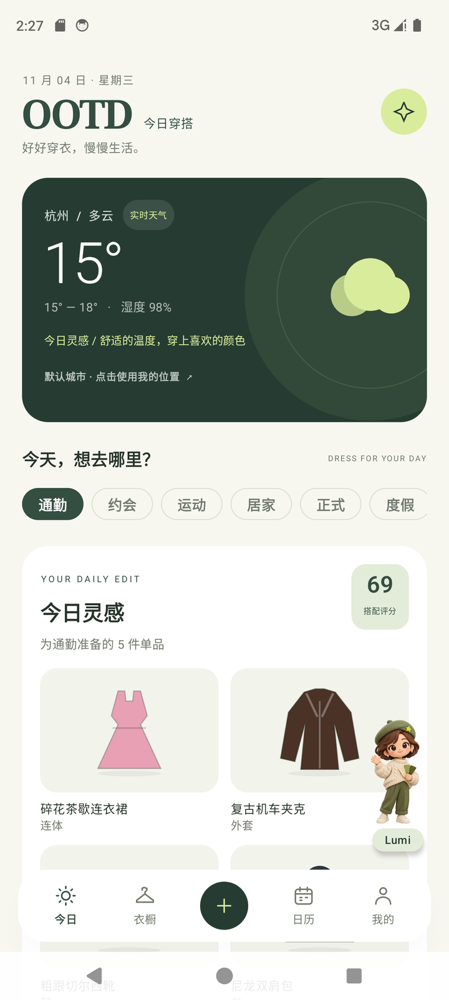
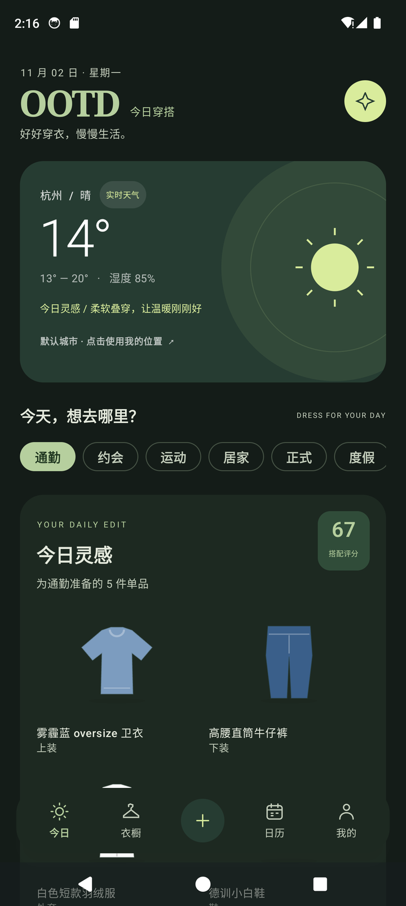
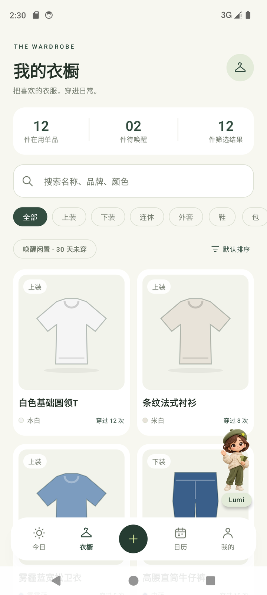
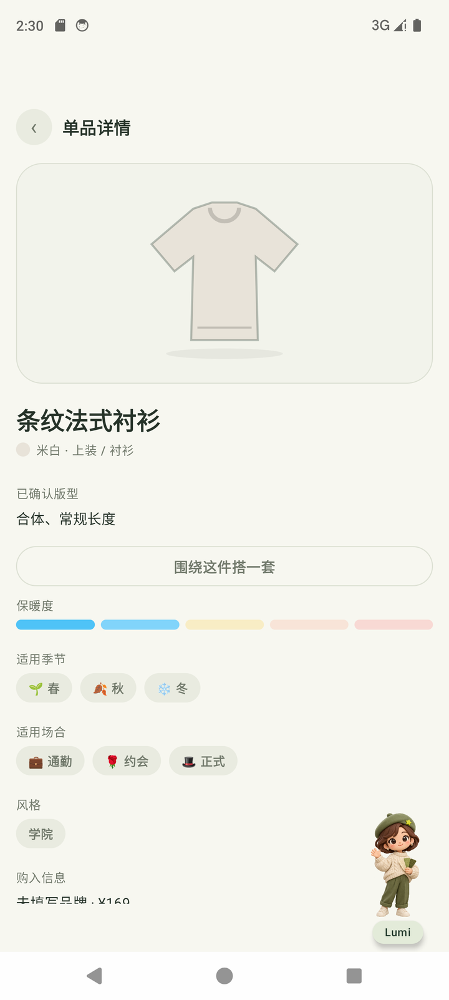
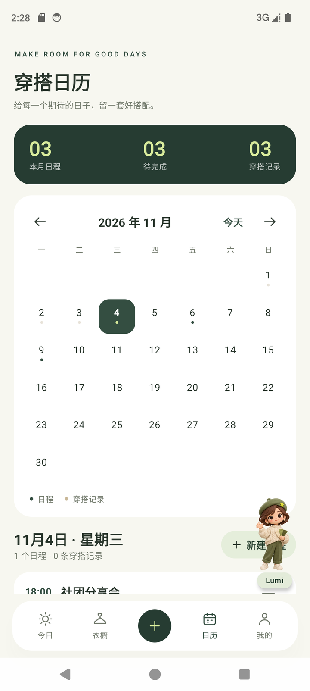
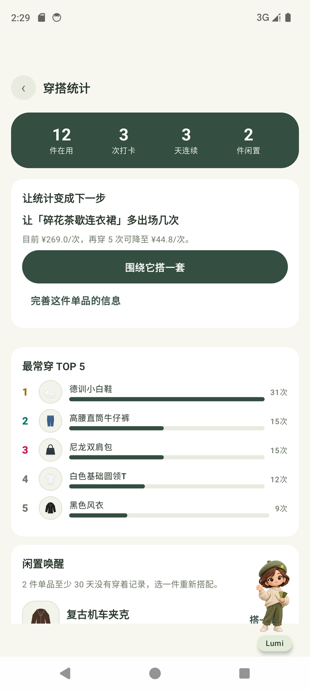
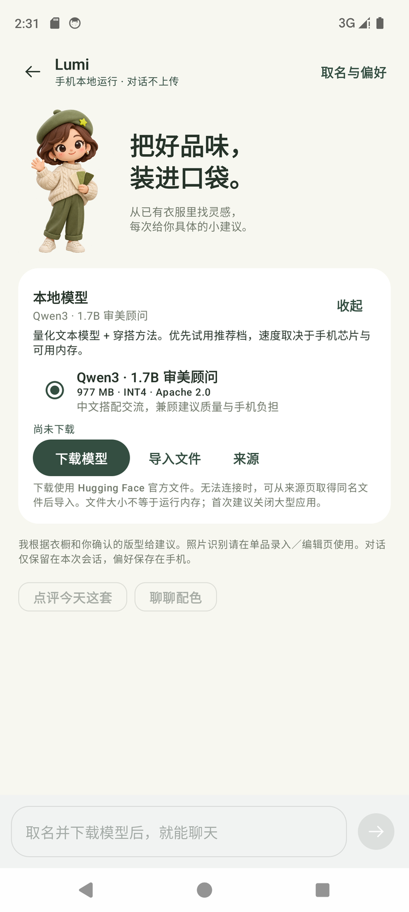
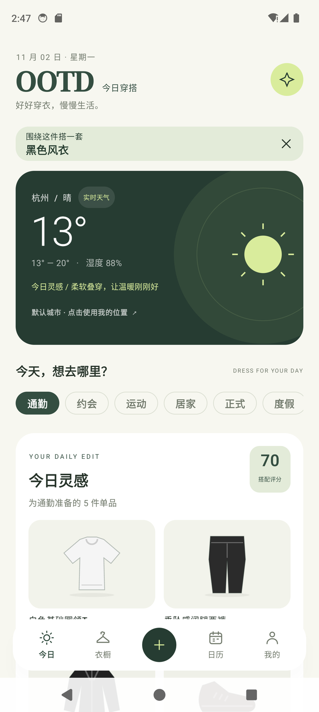

<div align="center">

# 今日穿搭 · OOTD Today

**把你已经拥有的衣服，变成每天都能用的衣橱。**

[](LICENSE)
[](https://github.com/xunhua666/ootd-today/actions/workflows/android.yml)
[-3DDC84?logo=android&logoColor=white)]()
[]()
[]()

</div>

## 这是什么

一个 Android 原生应用：录入自己的衣服 → 根据天气、场合和日程生成成套搭配 → 打卡记录穿着 → 用统计和日历把「今天穿什么」变成一件不需要犹豫的事。

它**不卖衣服、不做导购**，推荐只围绕用户衣橱里已有的单品；当一套衣服凑不出来时，它会说明缺什么，而不是给购物清单。

> 当前状态：**v1.5 功能原型**，可用于学习和二次开发。真实照片的识别准确率、普通手机上的本地模型速度/温度/内存尚未完成系统评测，详见 [已知限制](#已知限制)。

## 截图

| 今日 | 深色模式 | 我的衣橱 | 版型识别 |
|:--:|:--:|:--:|:--:|
|  |  |  |  |

| 穿搭日历 | 统计与建议 | 本地审美专家 | 搭配详情 |
|:--:|:--:|:--:|:--:|
|  |  |  |  |

> 截图来自测试构建，单品、次数与日程均为演示数据。

## 功能

- **衣橱管理**：7 大品类、颜色、季节、场合、风格、保暖度、版型标签；分类 / 搜索 / 闲置排序；首次使用有明确标注的体验衣橱，可一键切换为个人衣橱。
- **每日推荐**：本地规则引擎按天气（实时 Open-Meteo，失败回退离线示例）、场合、季节、近期去重、闲置唤醒和审美打分选出一整套搭配，并给出人话推荐理由。
- **反馈与采纳**：👍/👎 会调整本次会话内的推荐权重；「就穿这套」写入打卡，并累加单品的穿着次数。
- **穿搭日历**：月视图 + 日程（标题、日期、时间、场合、地点、备注、预选单品），支持完成/撤销/编辑/删除，Room 迁移保留历史数据。
- **统计与行动建议**：穿着次数、单次穿着成本、「再穿 5 次」的算术情景，并可直接围绕某件单品重新搭一套。
- **版型识别（可选）**：把单件衣服照片经用户明确确认后上传到兼容 OpenAI 的视觉接口，返回版型候选（fit / length / rise / cut / shoulder），用户逐项确认后才写入衣橱；照片在本地缩放、纠正 EXIF 旋转并重新编码，去掉原始 EXIF。
- **审美专家（可选）**：
  - 云端：任何 OpenAI 兼容的 Chat Completions 服务，支持追问（本地先做意图归一化，如「换条裤子」「太素了」）。
  - 本地：LiteRT-LM + Qwen3-1.7B INT4，需用户自行下载约 977 MB 模型（SHA-256 校验），纯离线对话，不上传衣橱和聊天内容。
- **每日提醒**：WorkManager 定时推送，与 App 内推荐使用同一套引擎。
- **社区**：本地 Room 实现的示例动态流（发布、点赞、评论、话题），**不是**真实社交网络。

## 技术栈

| 层 | 选型 |
|---|---|
| 语言 / UI | Kotlin 2.3.21、Jetpack Compose（Material 3，BOM 2026.02.01）、单 Activity + Navigation Compose |
| 架构 | MVVM + 单向数据流（StateFlow），Hilt 依赖注入，KSP 注解处理 |
| 存储 | Room 2.8.4（数据库 v5，含 1→5 迁移链与 schema 导出）、DataStore Preferences |
| 网络 | 原生 `HttpURLConnection` 封装（Open-Meteo 天气、OpenAI 兼容对话/视觉接口） |
| 设备能力 | CameraX、LocationManager（不依赖 GMS）、ML Kit 图像打标、WorkManager |
| 本地推理 | LiteRT-LM Android 0.19.0（Qwen3-1.7B INT4） |
| 构建 | AGP 9.3.2、Gradle 9.5.0、JDK 21、compileSdk/targetSdk 37、minSdk 24 |

## 架构

```
app/src/main/java/com/ootd/today/
├── data/
│   ├── local/        Room 实体、DAO、迁移、体验数据、模型下载与快照编解码
│   ├── model/        纯数据模型（WardrobeItem / Outfit / Weather / GarmentShape ...）
│   ├── repository/   仓库实现：衣橱、社区、天气、定位、云视觉、本地/云端专家
│   ├── prefs/        DataStore 设置
│   └── crypto/       Android Keystore AES/GCM 密钥存储
├── domain/           纯 Kotlin 业务规则：推荐引擎、审美评分、版型规则、意图解析
│   ├── stylist/      专家提示词、模型清单与校验、建议解析
│   └── vision/       视觉接口 JSON 协议与保守解析
├── ui/               Compose 页面 + ViewModel（today / wardrobe / add / camera / calendar / stats / community / expert / settings）
├── notification/     每日提醒 Worker 与通知
├── di/               Hilt 模块
├── MainActivity.kt
└── OotdApplication.kt
```

几个值得一读的设计点：

- **推荐是两步打分**：先给单品打分（保暖 0.34、季节 0.14、闲置唤醒 0.12、近期去重 0.10、场合通用 0.30），再对整套组合打分（单品均分 0.65 + 审美 0.35）。场合是硬过滤，不是降权；「上装+下装/连体装+鞋」是硬性完整性约束。
- **审美分**由配色关系（同色 / 邻近 / 撞色分段计分）、色系数量纪律、风格统一度和已确认版型共同决定，推荐理由与评分同源，避免「说的」和「算的」是两套逻辑。
- **所有失败都不抛给用户**：云专家不可用、视觉接口失败、定位失败都有本地回退路径。
- **体验数据用负数 id** 标记，永不落库、不计入个人统计，升级时不会与真实数据混淆。

详细说明见 [docs/ARCHITECTURE.md](docs/ARCHITECTURE.md)。

## 快速开始

### 环境要求

- JDK **21**（Gradle 9.5 与 AGP 9.3.2 不支持 JDK 8）
- Android SDK Platform **37.0（API 37）**、Build-Tools 36.0.0
- Android Studio（可选，任意支持 AGP 9 的版本）

### 构建与测试

```bash
git clone https://github.com/xunhua666/ootd-today.git
cd ootd-today

# 本地调试
./gradlew :app:assembleDebug
./gradlew :app:testDebugUnitTest
./gradlew :app:lintDebug

# 发布产物（先在项目根目录放 keystore.properties，详见 docs/RELEASING.md）
./gradlew :app:assembleRelease :app:bundleRelease

# 校验 16 KB 页面大小兼容（Google Play 对 targetSdk 35+ 的硬性要求）
python3 scripts/check_16kb.py \
  app/build/outputs/apk/release/app-release.apk \
  app/build/outputs/bundle/release/app-release.aab
```

没有 `keystore.properties` 时 release 会回退到 debug 签名，本机验证够用；
**上架 Google Play 必须使用自己的 upload key**（Play App Signing），流程见 [docs/RELEASING.md](docs/RELEASING.md)。

Windows 下用 `.\gradlew.bat`。首次构建需要联网下载依赖。

设备测试（需要已连接模拟器或真机）：

```bash
./gradlew :app:connectedDebugAndroidTest
```

### 可选的外部服务

应用**不内置任何 API Key**。不配置也能使用全部本地规则功能：

| 能力 | 配置位置 | 说明 |
|---|---|---|
| 云视觉（版型候选） | 我的 → 设置 → 版型识别 | 任意兼容 OpenAI Chat Completions 的视觉模型，默认模型名 `qwen3-vl-plus`；上传前有单独确认 |
| 云端审美专家 | 我的 → 设置 → 审美专家 | 服务商预设或自定义 baseUrl / 模型 / Key |
| 本地审美专家 | 专家页 → 下载模型 | 需下载约 977 MB 的 Qwen3-1.7B INT4，支持断点状态、SHA-256 校验、导入与删除 |

API Key 通过 Android Keystore（AES/GCM）加密后保存在应用私有 DataStore 中；Keystore 不可用的设备会降级为 `plain:` 前缀的本地编码存储（仅私有目录可读，未 root 的设备其他应用无法访问）。详见 [docs/PRIVACY.md](docs/PRIVACY.md)。

## 测试

| 类型 | 内容 |
|---|---|
| JVM 单元测试 | 20 个测试类、**164 项**，覆盖推荐引擎、审美评分、版型规则、配色计算、意图解析、快照编解码、日历日期、社区文本、HTTP 传输安全等纯逻辑；最近一次运行 0 失败 |
| 设备测试 | Room 迁移、视觉同意流程、日程 UI 拖拽与增删 |

```bash
./gradlew :app:testDebugUnitTest   # 纯 JVM，无需设备
```

## 已知限制

- **原型定位**：没有账号系统、没有服务端、没有运营后台；社区是本地体验内容。
- **识别准确率未评测**：云视觉只做了协议与保守解析的单元测试，未做真实照片准确率评测；版型标签都允许用户手动修改。
- **本地模型性能未评测**：1.7B 模型在 6–8 GB 内存真机上的速度、发热和峰值内存仍需实测；每次请求会新建推理 Engine，冷启动较慢。
- **云服务需要自备 Key**：面向普通用户的产品化还需要服务端代理、额度与限流。
- **未做多语言**：界面文案目前直接写在 Compose 代码中，`res/values/strings.xml` 尚未接入，海外上架前需要英文版本。
- **上架准备中**：隐私政策托管、Data Safety 表单、AI 内容举报入口、商店素材尚未完成，清单见 [docs/RELEASING.md](docs/RELEASING.md)。
- **签名**：仓库不包含 keystore；上架需要自建 upload key 并启用 Play App Signing，流程见 [docs/RELEASING.md](docs/RELEASING.md)。
- **原生库 16 KB 页面大小**：已通过 ML Kit 17.0.9 + `scripts/check_16kb.py` 校验（arm64/x86_64 全部 `PT_LOAD` ≥ 16 KB）。

## 参与贡献

欢迎 Issue 和 PR，请先读 [CONTRIBUTING.md](CONTRIBUTING.md)。安全问题请按 [SECURITY.md](SECURITY.md) 私下报告，不要公开提交包含密钥或用户照片的 Issue。

## 商店上架资料

- 发布与签名流程：[docs/RELEASING.md](docs/RELEASING.md)
- 商店文案与素材清单：[docs/STORE_LISTING.md](docs/STORE_LISTING.md)
- Play 数据安全表单对照：[docs/DATA_SAFETY.md](docs/DATA_SAFETY.md)
- AI 功能与合规说明：[docs/AI_POLICY.md](docs/AI_POLICY.md)
- 英文隐私政策：[docs/privacy.html](docs/privacy.html)
- 英文界面迁移进度：[docs/I18N_PROGRESS.md](docs/I18N_PROGRESS.md)

## 许可证

本项目以 [Apache License 2.0](LICENSE) 开源，可自由使用、修改和商用，需保留版权与许可声明；第三方组件与素材的许可见 [NOTICE](NOTICE)。

---

## English summary

**OOTD Today** is a native Android app (Kotlin + Jetpack Compose) that turns the clothes you already own into a usable wardrobe: describe garments, get weather/occasion-aware outfit recommendations from an on-device rule engine, log what you wore, plan outfits in a calendar, and inspect cost-per-wear. Optional cloud vision and an optional local Qwen3-1.7B expert can be enabled by the user. Everything else works offline; no telemetry is collected.

- Min SDK 24 (Android 7.0), target SDK 37, JDK 21 required to build.
- Unit tests run on the JVM: `./gradlew :app:testDebugUnitTest`.
- Licensed under Apache-2.0. See [docs/ARCHITECTURE.md](docs/ARCHITECTURE.md) for the design notes.